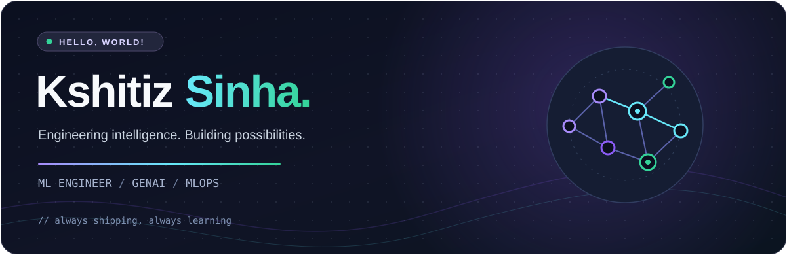

<div align="center">



<br />

<a href="https://github.com/YOUR_USERNAME?tab=followers"></a>


<br /><br />

**ML Engineer · GenAI Software Engineer · MLOps & AI Infrastructure**

*I turn ambitious ideas into intelligent systems — from the first prototype to production scale.*

</div>

---

### `> whoami`

```yaml
name: Kshitiz Sinha
currently: Supplywhy.ai
since: October 2026
working_on:
  - LLM serving, inference optimization and orchestration
  - Production-grade GenAI systems and MLOps
  - AI-native developer tools and useful side projects
curious_about:
  - Efficient local inference and long-context models
  - Distributed systems, Kubernetes and observability
  - Making powerful AI more accessible
motto: "Build boldly. Measure everything. Keep learning."
```

### ✦ Currently writing my next chapter

<table>
<tr>
<td width="59%" valign="top">

**💼 Professional journey**

| Timeline | Chapter |
| :-- | :-- |
| **Oct 2026 — Present** | **Supplywhy.ai** · AI/ML Engineering |
| **Previously** | **Thoucentric Technology Pvt. Ltd.** · Engineering |

I enjoy the space where **machine learning, systems engineering, and product thinking** overlap. My favorite projects are the ones that go beyond a demo and become something people can actually use.

</td>
<td width="41%" valign="top">

**⚡ What I care about**

- 🧠 LLMs that are **fast, useful, and reliable**
- 🏗️ Infrastructure that **scales gracefully**
- 🛠️ Tools that **solve real problems**
- 🌏 Learning languages and exploring Japan
- 🌱 Building something new, constantly

</td>
</tr>
</table>

### `// the toolkit`

<div align="center">


<br /><br />

`LLM Inference` · `RAG & Agents` · `Model Serving` · `MLOps` · `API Architecture` · `Observability` · `Distributed Systems`

</div>

### ⌁ Things I'm building & exploring

<table>
<tr>
<td width="50%" valign="top">

#### 🧠 LLM Performance Lab

Experimenting with **quantized local models**, multi-GPU inference, long-context serving, KV-cache strategy and real-world throughput optimization.

`llama.cpp` `CUDA` `GGUF` `Inference`

</td>
<td width="50%" valign="top">

#### ⚡ Load Router

A unified gateway for local and hosted LLM providers, with **rate-aware routing**, queuing, token management and usage analytics.

`Python` `Redis` `PostgreSQL` `APIs`

</td>
</tr>
<tr>
<td width="50%" valign="top">

#### ☁️ Intelligent API Gateway

A Kubernetes-aware traffic gateway exploring **autoscaling, scale-to-zero**, lazy wake-up and lightweight traffic intelligence.

`FastAPI` `Kubernetes` `Redis` `Metrics`

</td>
<td width="50%" valign="top">

#### 🎌 AI-Powered Learning

Exploring delightful learning experiences with **interactive tutors**, adaptive study flows and visually rich Japanese study tools.

`Next.js` `GenAI` `Learning UX`

</td>
</tr>
</table>

<details>
<summary><b>✦ More ideas on my workbench</b></summary>
<br />

- **The Essence Times** — a modern publication workflow with automated content production.
- **Habit Builder** — time-aware habits, streaks, goals and thoughtful feedback loops.
- **Study Platform** — adaptive roadmaps, classroom workflows, homework and learning analytics.
- **Mail Intelligence** — an AI-first inbox briefing and personalized triage experience.

</details>

### `> git status --short`

<div align="center">

<!-- Replace YOUR_USERNAME in the URLs below with your real GitHub username. -->


<br />


</div>

### ♡ A little more human

```text
Beyond the terminal:
  ♫ Anime soundtracks and Japanese music
  🗾 Japan, quiet places and discovering new corners of the world
  📖 Learning Japanese, one day at a time
  ☕ A habit of turning "what if?" into a side project
```

<div align="center">


**Have an interesting problem to solve?** I'm always happy to connect with builders and curious minds.

<a href="https://github.com/YOUR_USERNAME"></a>

<sub>Made with curiosity, caffeine, and an unreasonable number of side projects. ✨</sub>

</div>
